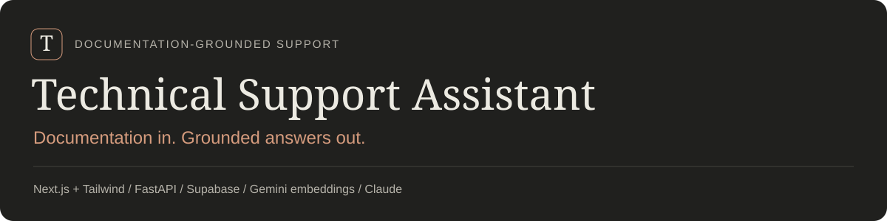
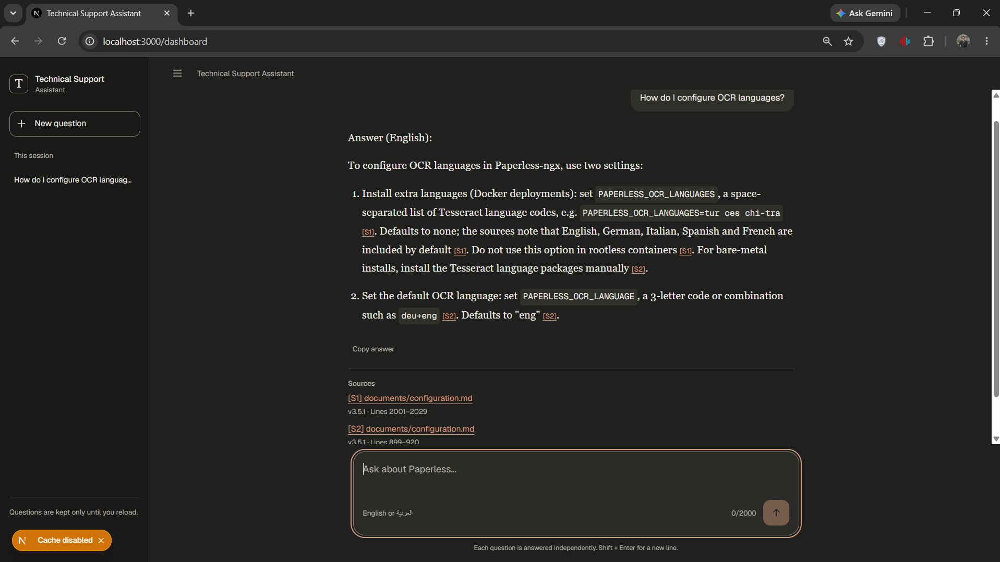
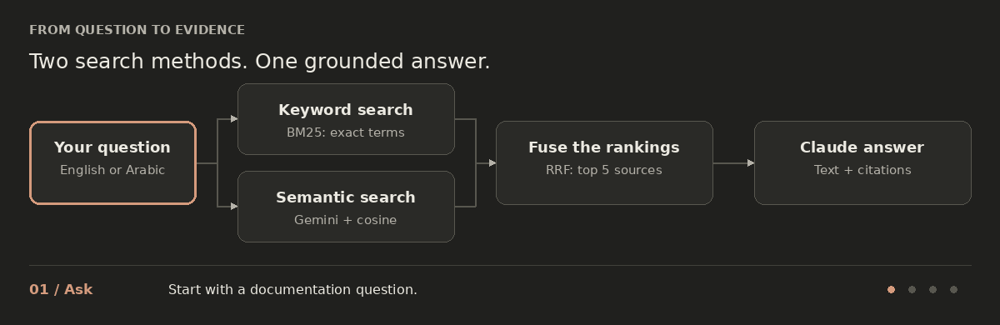
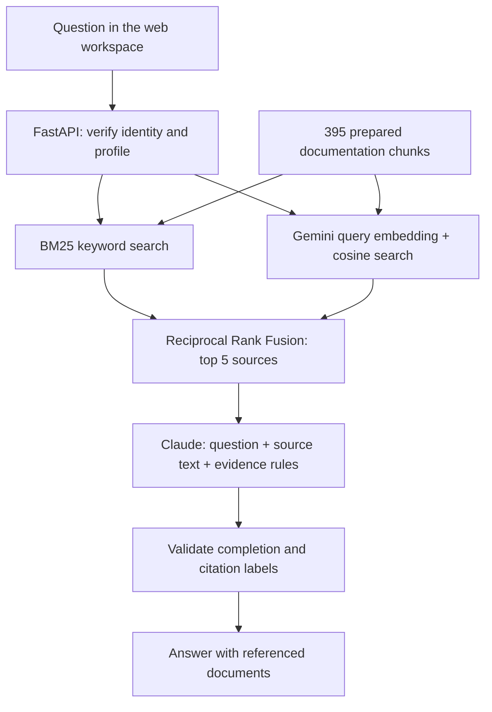

<a id="technical-support-assistant"></a>

<p align="center">
  
</p>

<p align="center">
  <a href="https://github.com/devMo76/Technical-Support-Assistant/actions/workflows/ci.yml"></a>
  
  
</p>

<p align="center">
  <strong>Ask about Paperless-ngx. Read a concise answer. Follow the evidence.</strong>
</p>

<p align="center">
  <a href="#see-it-in-action">Preview</a> ·
  <a href="#how-it-works">Architecture</a> ·
  <a href="#run-it-locally">Quick start</a> ·
  <a href="#course-concepts-in-practice">Course concepts</a> ·
  <a href="#what-is-built-and-what-is-next">Roadmap</a>
</p>

A documentation-grounded support assistant built as a practical application of the Anthropic course. It combines **keyword search**, **semantic search** and **Claude** to answer questions using a pinned set of Paperless-ngx guides, with document references and source line ranges.

**Current scope:** a working local web prototype. Questions are independent; the app does not inspect a live Paperless server or remember earlier questions as conversational context. No hosted demo is linked yet.

## See it in action

<a href="docs/assets/workspace.png">
  
</a>

*Actual development screenshot. Click to enlarge. The source references beneath an answer make its evidence inspectable.*

### Questions worth trying

| Try asking | What the assistant should do |
| :--- | :--- |
| How do I configure OCR languages? | Explain the relevant settings, retain environment restrictions and cite the documentation. |
| Can a document have multiple tags? | Answer directly and reference the supporting passage. |
| كيف أغيّر لغة التعرف على النصوص وأضيف لغات جديدة؟ | Retrieve relevant English documentation and answer in Arabic, with readable RTL text. |
| How much free disk space is on my server right now? | Explain that static documentation cannot reveal live server measurements. |

These are examples of intended behaviour, not a guarantee that every generated answer will be correct.

## What makes it useful

- **Evidence beside the answer.** Cited references include the source file, documentation version and inclusive line range.
- **Two search methods, one result list.** BM25 handles exact setting names and error messages; embeddings handle related meaning and cross-language questions.
- **English and Arabic.** Arabic answers render right to left while commands and setting names retain their original form.
- **A focused support workspace.** Responsive navigation, Markdown, copy controls, pending states and retry feedback.
- **Self-service accounts.** Email/password registration and sign-in through Supabase, with protected backend requests and separate staff/admin privileges.
- **Repeatable preparation.** Source hashes, deterministic chunks and resumable embeddings keep the document pipeline inspectable.

## How it works

<p align="center">
  
</p>

*Concept animation of the implemented retrieval flow, not a recording or live progress indicator. Prefer still graphics? [Open the static workflow](docs/assets/retrieval-flow.svg).*



The document pipeline runs ahead of the question: **verify sources → split by headings and blocks → attach metadata → generate embeddings**. At query time, the application embeds the question, searches the existing records and supplies the actual retrieved text to Claude.

<details>
<summary><strong>Explore the retrieval settings</strong></summary>

| Setting | Current implementation |
| :--- | :--- |
| Source corpus | 5 Markdown guides from Paperless-ngx `v3.5.1` |
| Searchable records | 395 chunks |
| Chunk target | 2,000 characters; paragraphs, code blocks and tables can exceed the soft limit |
| Embedding model | `gemini-embedding-2` |
| Embedding dimensions | 768 |
| Candidate limit | Up to 20 results from each search method |
| Fusion | Reciprocal Rank Fusion, constant `60` |
| Context supplied to Claude | Top 5 fused records with text and provenance |
| Answer model | Set through `ANTHROPIC_MODEL` |
| Generation settings | Low effort, thinking disabled, up to 700 output tokens for answers |
| Storage today | Checked-in JSONL records; no vector database required |

The intact permissions table exceeds the chunk target intentionally. Citation-label validation checks that references exist; it does **not** prove that each claim is supported. Answer review remains necessary.

</details>

## Course concepts in practice

| Concept | What was built | Explore the code |
| :--- | :--- | :--- |
| Document preparation | Hash verification, heading-aware chunks and source metadata | [Chunking](backend/ingestion/chunk_documents.py) |
| Embeddings | Resumable generation and consistent vector dimensions | [Embedding pipeline](backend/ingestion/embed_documents.py) |
| Semantic retrieval | Query embeddings and cosine similarity | [Semantic search](backend/retrieval/semantic_search.py) |
| Keyword retrieval | BM25 ranking over document tokens | [Keyword search](backend/retrieval/keyword_search.py) |
| Hybrid retrieval | Merge rankings with Reciprocal Rank Fusion | [Hybrid search](backend/retrieval/hybrid_search.py) |
| Retrieval-augmented generation | Send the question and retrieved text to Claude | [Answer generation](backend/answer_question.py) |
| Prompt engineering | Evidence rules, answer language, restrictions and abstention | [System prompt](backend/answer_question.py) |
| API response handling | Text blocks, stop reasons, token usage and citation labels | [Claude service](backend/claude_service.py) · [Answer handling](backend/answer_question.py) |
| Evaluation and iteration | Evidence coverage and answer review against development cases | [Evaluation scripts](backend/evaluation/) |

**Next course-focused work:** multi-turn context, streaming and tool use with reviewed escalation. These are planned capabilities, not existing buttons or completed integrations.

## Run it locally

You need **Python 3.13**, **Node.js 22**, a **Supabase project**, an **Anthropic API key** and a **Gemini API key**. Existing document embeddings are included; question-time semantic search still uses Gemini.

<details>
<summary><strong>1 · Install dependencies</strong></summary>

Run from the repository root in PowerShell:

```powershell
git clone https://github.com/devMo76/Technical-Support-Assistant.git
cd Technical-Support-Assistant
python -m venv .venv
.\.venv\Scripts\python.exe -m pip install -r backend/requirements.txt
cd frontend
npm ci
cd ..
```

</details>

<details>
<summary><strong>2 · Configure credentials and Supabase</strong></summary>

```powershell
Copy-Item backend/.env.example backend/.env
Copy-Item frontend/.env.example frontend/.env.local
```

Fill in the blank values in both files. The **same Supabase URL and publishable key** must be configured separately for frontend and backend. Keep Anthropic and Gemini keys server-only, and keep `ANTHROPIC_EFFORT=low`.

Apply the database migration to the intended Supabase project, then configure hosted registration. See the complete [local setup and authentication guide](docs/SETUP.md), including the simpler development flow without confirmation emails.

**Configuration note:** the checked-in `supabase/config.toml` currently disables local sign-up. Hosted Dashboard settings are separate; adding a signup page does not enable registration by itself.

Never commit real `.env` files or put a service-role/secret key in `NEXT_PUBLIC_*` variables.

</details>

<details open>
<summary><strong>3 · Start both services</strong></summary>

Backend terminal, from the repository root:

```powershell
.\.venv\Scripts\python.exe -m uvicorn backend.main:app --reload
```

Frontend terminal:

```powershell
cd frontend
npm run dev
```

Open **[the website](http://localhost:3000)**, create an account and ask a documentation question. The backend health check is at [127.0.0.1:8000/health](http://127.0.0.1:8000/health).

Live questions call Gemini and Claude. API availability, quotas and charges depend on the configured provider accounts; this is not an entirely offline or guaranteed-free application.

</details>

## Evaluation and quality checks

The development set contains **10 cases**: **9 answerable retrieval cases** and **1 abstention case**. It includes English, Arabic and mixed-language questions. [Browse the questions](evals/paperless/QA_Questions.md) and [saved answer reports](evals/paperless/results/answers/).

- Retrieval evaluation checks whether expected evidence passages are covered by the top 5 records.
- Answer reports retain the generated answer, supplied sources, token counts and review fields.
- These are development cases, not a held-out benchmark. Retrieval success is not the same as answer correctness.

<details>
<summary><strong>Run local checks without model API calls</strong></summary>

```powershell
.\.venv\Scripts\python.exe -m unittest discover -s backend/tests
.\.venv\Scripts\python.exe -m compileall -q backend
cd frontend
npm run lint
npx tsc --noEmit
npm test
npm run build
cd ..
```

[GitHub Actions](https://github.com/devMo76/Technical-Support-Assistant/actions/workflows/ci.yml) runs backend tests, frontend authentication tests, linting and a production build. Mocked unit tests do not replace RLS checks against an isolated Supabase database or manual chat checks.

</details>

<details>
<summary><strong>Run the document pipeline and live evaluations</strong></summary>

From the repository root:

```powershell
# Local document processing; no model calls
.\.venv\Scripts\python.exe -m backend.ingestion.chunk_documents

# Calls Gemini for any missing document embeddings
.\.venv\Scripts\python.exe -m backend.ingestion.embed_documents --limit 395

# Calls Gemini for query embeddings
.\.venv\Scripts\python.exe -m backend.evaluation.evaluate_retrieval

# Calls Gemini and Claude; existing reports are protected from overwrite
.\.venv\Scripts\python.exe -m backend.evaluation.evaluate_answers --case Q01
```

Use `--overwrite` on answer evaluation only when intentionally replacing an existing report with a fresh model request.

</details>

## What is built and what is next

| Area | Status |
| :--- | :--- |
| Source verification, chunking and embeddings | Implemented |
| Semantic, keyword and hybrid search | Implemented |
| Source-grounded answers and citation labels | Implemented; factual support requires evaluation |
| English/Arabic workspace and responsive navigation | Implemented |
| Registration, login, protected API and database role rules | Implemented; email flow depends on Supabase settings |
| Development evaluation scripts and CI | Implemented |
| Persistent conversations and multi-turn context | Planned |
| Streaming responses | Planned |
| Tool-driven escalation and ticket approval | Planned |
| Public deployment and production hardening | Planned |

## Explore the repository

| Location | Purpose |
| :--- | :--- |
| [`frontend/src/components/chat/`](frontend/src/components/chat/) | Tailwind workspace, Markdown answers and source links |
| [`frontend/src/app/`](frontend/src/app/) | Login, signup, confirmation and protected dashboard routes |
| [`backend/chat.py`](backend/chat.py) | Authenticated `POST /chat` endpoint |
| [`backend/ingestion/`](backend/ingestion/) | Chunking and embedding preparation |
| [`backend/retrieval/`](backend/retrieval/) | BM25, cosine search and rank fusion |
| [`backend/evaluation/`](backend/evaluation/) | Retrieval and answer evaluation commands |
| [`data/paperless/`](data/paperless/) | Pinned source guides, provenance and processed records |
| [`evals/paperless/`](evals/paperless/) | Development questions and saved answer reports |
| [`supabase/migrations/`](supabase/migrations/) | Profiles, role management and owner-scoped RLS |

## Source material and scope

The five guides are pinned to **Paperless-ngx v3.5.1**, source commit `35b0439195bbdb87a6d519152e6782abe0720c3b`. Their provenance is recorded in [`sources.json`](data/paperless/sources.json); upstream licensing is preserved in [`data/paperless/LICENSE`](data/paperless/LICENSE).

This is an independent learning project, not an official Paperless-ngx or Anthropic product. The upstream document license applies to that source material; it should not be mistaken for a separate license grant for all application code.

<p align="right"><a href="#technical-support-assistant">Back to top ↑</a></p>
